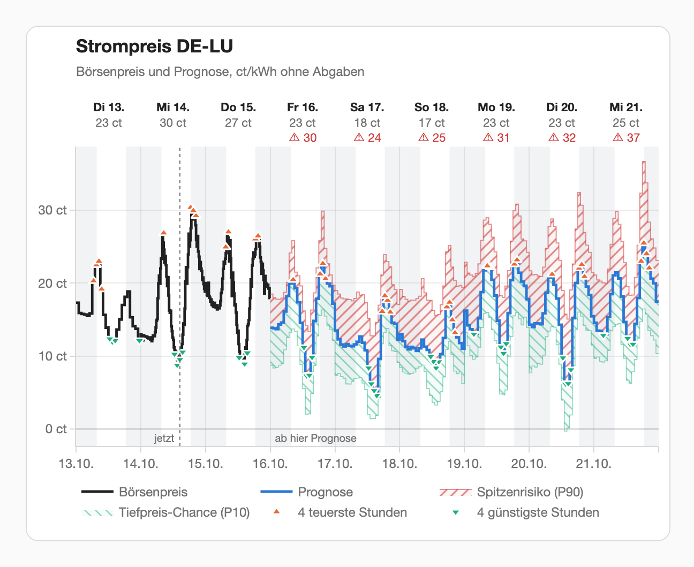
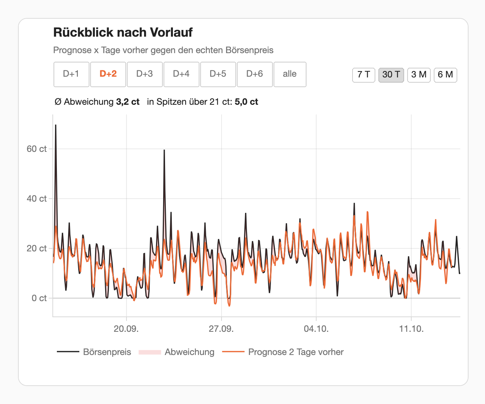

# Spot Forecast

<p align="center">
  
</p>

[![GitHub Release][release-badge]][release-url]
[![GitHub Downloads (spot_forecast.zip, all releases)][downloads-badge]][release-url]
[![HACS Custom][hacs-badge]][hacs-url]
[![HA Version][ha-badge]][ha-url]
[![License][license-badge]][license-url]
[![GitHub commit activity][commits-badge]][commits-url]
[![Validate][validate-badge]][validate-url]
[![GitHub Stars][stars-badge]][stars-url]

**Day-ahead electricity prices for Germany, Luxembourg, the Netherlands, Denmark and southern Norway, six days further than the auction.**

[Project website](https://cygnusb.github.io/ha-spot-forecast/) · [Documentation](https://cygnusb.github.io/ha-spot-forecast/docs/) · [Releases](https://github.com/cygnusb/ha-spot-forecast/releases)

The day-ahead auction publishes prices for today and, from about 13:00, for
tomorrow. Anyone who plans a home battery, an electric car or a heat pump
further ahead has to guess. Spot Forecast is a Home Assistant integration that
fills the six days after the last published price with an hourly forecast for
the DE-LU, NL, DK1, DK2 or NO2 bidding zone (see [Supported zones](#supported-zones)), and says how far to
trust it: an expected price per
hour, a **peak-risk** value that the price exceeded in 12–13 % of the hours of
the backtest (the target is one in ten), and a
**low-price** value for likely negative prices.

It runs on open data (Energy-Charts and Open-Meteo), needs no account and no
API key, and is light enough for a Raspberry Pi: the models are trained every
month on GitHub and only evaluated on your device, with numpy.

<p align="center">
  <a href="assets/screenshots/forecast_light.png">
    <picture>
      <source media="(prefers-color-scheme: dark)" srcset="assets/screenshots/forecast_dark.png">
      
    </picture>
  </a>
  <br>
  <em>The forecast card on 14 October 2026, two weeks after the bundled model's training cutoff: an out-of-sample forecast from the shipped model on real data. Card labels are German.</em>
</p>

## How it works

1. **Known prices.** The last 40 days of the zone's day-ahead prices from
   Energy-Charts, in one request (DK1 and DK2: also DE-LU's, in a second one).
2. **Weather forecast.** ECMWF IFS (0.25°) from Open-Meteo for the zone's own
   points and its neighbours' (DE-LU: 10 points in Germany and 12 in neighbouring
   countries; NL: 7 in and off the Netherlands and 7 around it; DK1 and DK2: 4–5 in
   Denmark, 7–8 around it and the 22 DE-LU points; NO2: 4 in southern Norway and 8 around
   it, and the last 90 days' precipitation and temperature of six hydro points): wind at
   100 m, solar radiation, temperature, cloud cover and precipitation. Weather carries most of the
   skill: without it the error stays close to the naive baseline's.
3. **Three tree models.** Gradient-boosted trees predict, per hour, the
   expected price (median), a peak-risk value (P90) and a low-price value
   (P10), relative to the recent price level, for every hour of the six days
   after the latest known day.
4. **Calibration.** Every forecast is kept. The P90 and P10 bands are shifted
   by how often they were crossed over the last 56 days, so the peak risk stays
   near one hour in ten. On install, a backfill supplies that history.
5. **Output.** One price sensor with known and forecast slots, two warning
   sensors, and long-term statistics of every forecast against the actual
   price for the look-back card.

A run repeats after each new weather model run (four times a day) and again
once the auction result for tomorrow is published. Before that, the forecast
covers tomorrow to today + 6; after it, today + 2 to today + 7. Known prices
always come first and the forecast follows without a gap. Details:
[how the model works](docs/model.md).

## How good is it?

Out of sample, walk-forward: the models were refit month by month on past data
only and forecast days they had never seen, with weather forecasts never
fresher than, and up to a day older than, what a live install uses. Mean
absolute error (MAE) in ct/kWh for DE-LU, from the shipped model's own report
(`de_lu-2026-10`; NL in [Supported zones](#supported-zones)):

| Horizon | MAE Apr 2025 – Sep 2026 | Naive MAE, same period | Skill, same period | MAE Jul – Sep 2026 | Naive MAE, Jul – Sep 2026 | Skill, Jul – Sep 2026 | Above peak risk |
|---|---|---|---|---|---|---|---|
| D+1 | 1.70 | 3.39 | 50% | 1.99 | 4.29 | 54% | 12% |
| D+2 | 1.78 | 3.39 | 48% | 2.14 | 4.29 | 50% | 12% |
| D+3 | 1.89 | 3.39 | 44% | 2.29 | 4.29 | 47% | 12% |
| D+4 | 2.04 | 3.39 | 40% | 2.50 | 4.29 | 42% | 12% |
| D+5 | 2.31 | 3.39 | 32% | 2.92 | 4.29 | 32% | 12% |
| D+6 | 2.43 | 3.39 | 28% | 3.03 | 4.29 | 29% | 12% |

*Naive* repeats the price of the same hour a week before. *Skill* is
1 − MAE ÷ naive MAE, which depends far less on how volatile the market was.
The model report has the naive MAE for the full period only; for July to
September 2026 it is computed from the bundled backfill and Energy-Charts
prices ([`tools/site_data.py`](tools/site_data.py)), on the same hours as the
report's MAE. *Above peak risk* (full period) is how often the actual price
exceeded the calibrated P90; the target is about 10 %.

> **Peaks come out too low.** The forecast gets the timing of price peaks
> right, not their height. In hours above 21.2 ct/kWh it is on average
> 7.5 ct too low one day ahead and 9.7 ct six days ahead. For peaks, use the
> peak-risk band (P90) and the peak-risk sensor that switches on it, not the
> expected price.

> **The error depends on the market.** From July 2026 gas and electricity
> prices were higher and more volatile, and the MAE rose to 1.99 ct (D+1) …
> 3.03 ct (D+6). The naive forecast got worse too (4.29 ct against 3.39 ct),
> so the skill held at 54 % … 29 %. A frozen model degrades within months when
> the market shifts, so new models are trained every month and can reach your
> install without an integration update (see
> [model updates](docs/model.md#model-updates)).

The low-price value catches negative prices: in 79–85 % of the hours that
turned out negative (depending on the horizon), P10 was below zero. More in
[accuracy](docs/accuracy.md); the [website](https://cygnusb.github.io/ha-spot-forecast/#accuracy)
has the forecast against the actual price, per horizon, as an interactive
chart.

## Supported zones

One entry per bidding zone, each with its own model, trained every month on its own prices
and weather points. MAE of the expected price in ct/kWh per horizon, April 2025 to
September 2026, and the skill over all horizons, from each shipped model's report:

| Zone | Area | D+1 | D+2 | D+3 | D+4 | D+5 | D+6 | Skill |
|---|---|---|---|---|---|---|---|---|
| DE-LU | Germany and Luxembourg | 1.70 | 1.78 | 1.89 | 2.04 | 2.31 | 2.43 | 40% |
| NL | Netherlands | 1.75 | 1.85 | 1.93 | 2.05 | 2.22 | 2.31 | 35% |
| DK1 | Denmark West | 1.67 | 1.75 | 1.89 | 2.08 | 2.38 | 2.51 | 44% |
| DK2 | Denmark East | 1.82 | 1.92 | 2.02 | 2.21 | 2.50 | 2.62 | 43% |
| NO2 | Southern Norway | 1.50 | 1.58 | 1.66 | 1.73 | 1.79 | 1.85 | 25% |

DE-LU uses ten weather points in Germany, twelve in the neighbouring countries and the
installed wind and solar capacity. NL uses seven points in and off the Netherlands and seven
in the neighbouring countries, with the zone-generic feature layout and no capacity data
(see [how the model works](docs/model.md)). NL's skill falls from 44 % one day ahead to
25 % six days ahead, against 50 % and 28 % for DE-LU. Per horizon and for the last three
months: [accuracy](docs/accuracy.md#netherlands-nl).

DK1 (Jutland and Funen) and DK2 (Zealand and Bornholm) are tightly coupled to Germany. Their
forecast is the average of the zone's own model, which also reads the German weather points
and DE-LU prices, and of the DE-LU model, which each DK model file carries inside it
([how](docs/model.md#dk1-and-dk2-blended-with-de-lu)). The average is better than either half
alone: 2.05 against 2.17 ct for DK1, 2.18 against 2.28 ct for DK2 over all horizons
([accuracy](docs/accuracy.md#denmark-west-dk1-and-denmark-east-dk2)).

NO2 (southern Norway) runs on hydropower, so its model also reads how much rain fell and how
warm it was over the last two weeks to three months at six catchment points, from the archived
forecasts of those days, and the rain forecast for the six days ahead
([how](docs/model.md#no2-hydro-features)). Its prices move less than the other zones', so an
MAE of 1.69 ct is a skill of 25 % ([accuracy](docs/accuracy.md#southern-norway-no2)). Prices
and forecasts are in EUR, as for every zone.

## Installation (HACS)

Spot Forecast is a HACS **custom repository** for now:

[![Open your Home Assistant instance and open this repository in HACS.][my-hacs-badge]][my-hacs-url]

1. Use the button above, or in HACS: ⋮ → *Custom repositories*, URL
   `https://github.com/cygnusb/ha-spot-forecast`, type *Integration*.
2. Download **Spot Forecast** in HACS and restart Home Assistant.
3. Add the integration:

   [![Open your Home Assistant instance and start setting up Spot Forecast.][my-flow-badge]][my-flow-url]

   or Settings → Devices & services → *Add integration* → **Spot Forecast**.

The integration ships with a trained model and works right after setup,
without access to GitHub.

## Configuration

Setup asks for one thing: the bidding zone (DE-LU, NL, DK1, DK2 or NO2; one entry per zone,
several can run side by side). The options (*Configure* on the integration):

| Option | Default | What it does |
|---|---|---|
| Grid fees and taxes | 0 | Gross per-kWh surcharge (EUR/kWh, VAT included) for a total-price sensor and the forecast card's "mit Abgaben" view; 0 = none. |
| VAT on the market price | 19 % (DE-LU), 21 % (NL), 25 % (DK1, DK2, NO2) | VAT charged on the exchange price for the total price: price × (1 + VAT/100) + surcharge. Set your own rate, e.g. in Luxembourg. |
| Peak price threshold | from the model, 21.2 ct/kWh | Wholesale price at or above which an hour counts as a peak, for the peak-risk sensor. |
| Backfill window (days) | 60 | Past days of forecasts reconstructed on first start, so the look-back and the calibration have history (0–180, 0 = off). |
| Update models automatically | on | Check for a newer model after setup and once a day, and download it if it passes its checks. Off stops further downloads; a model downloaded before stays in use. |

Details: [docs/configuration.md](docs/configuration.md).

## Entities

All prices are the bare exchange price in EUR/kWh, without grid fees, taxes or
supplier margin, except the total price. Entity ids are the same on every
instance language.

| Entity | Description |
|---|---|
| `sensor.spot_forecast_de_lu_price` | Current price. Attribute `prices`: every slot from today 00:00 to the end of the forecast |
| `sensor.spot_forecast_de_lu_total_price` | Current price with VAT plus the grid fees and taxes option, `prices` likewise (only while that option is set) |
| `binary_sensor.spot_forecast_de_lu_peak_risk` | On if a price at or above the threshold is known or likely (P90) in the next 48 h |
| `binary_sensor.spot_forecast_de_lu_negative_price` | On if a negative price is known or likely (P10) in the next 48 h |
| `sensor.spot_forecast_de_lu_day_0` … `_day_6` | Mean price per day, with min, max, P90 max and P10 min (disabled by default) |
| `sensor.spot_forecast_de_lu_last_run` | Last successful forecast run (diagnostic) |
| `sensor.spot_forecast_de_lu_model_version` | Active model, its source and training cutoff (diagnostic) |
| `sensor.spot_forecast_de_lu_forecast_error` | Mean absolute error over the last 30 days, per horizon as attributes (diagnostic) |
| `sensor.spot_forecast_de_lu_backfill_status` | Whether the backfill ran, and how many days it added (diagnostic) |

An entry of `prices`:

```json
{"time": "2026-10-17T18:00:00+02:00", "price": 0.2134, "p90": 0.3812, "p10": 0.142, "source": "forecast", "h": 2}
```

Known slots (`source: market`) keep their native resolution (15 minutes since
October 2025); forecast slots are hourly. The integration also writes hourly
long-term statistics: `spot_forecast:de_lu_price` (actual price) and
`spot_forecast:de_lu_forecast_h1` … `_h6` (the forecast made 1 … 6 days
before), plus `_peak_risk_h1…6` and `_low_h1…6`. All entities and attributes:
[docs/entities.md](docs/entities.md).

## Dashboard cards

Two cards for the [Plotly Graph Card](https://github.com/dbuezas/lovelace-plotly-graph-card),
written for v4.0.2. Install it from HACS, add a *Manual* card and paste the
YAML:

* [`examples/plotly_forecast.yaml`](examples/plotly_forecast.yaml): known
  prices and the six-day forecast with the peak-risk and low-price bands, the
  four dearest and cheapest hours per day, and a warning above each day whose
  peak risk crosses your threshold (the image at the top).
* [`examples/plotly_lookback.yaml`](examples/plotly_lookback.yaml): the
  forecast made D+1 … D+6 days ahead against the actual price, with the mean
  error over the shown range.

<p align="center">
  <a href="assets/screenshots/lookback_light.png"><picture><source media="(prefers-color-scheme: dark)" srcset="assets/screenshots/lookback_dark.png"></picture></a>
</p>

Both screenshots are real: [`tools/gen_card_screenshots.py`](tools/gen_card_screenshots.py)
renders the shipped YAML in the released card against states and statistics
that the integration's own code computes from the model and research data.
See [docs/cards.md](docs/cards.md).

## Using it with Smart Battery Pilot

[Smart Battery Pilot](https://github.com/cygnusb/ha-smart-battery-pilot) reads
the forecast as it is: select `sensor.spot_forecast_de_lu_price` as its price
entity. Its ENTSO-E adapter reads the `prices` attribute (`time`, `price`);
hours beyond the published market prices are marked `source: forecast` and
carry `p90` and `p10`, which the adapter ignores. Neither project imports the
other. See [docs/smart-battery-pilot.md](docs/smart-battery-pilot.md).

## Data sources and licences

| Data | Source | Licence |
|---|---|---|
| Day-ahead prices DE-LU, NL, DK1, DK2 and NO2 | [Energy-Charts](https://www.energy-charts.info/) (Fraunhofer ISE), price data from Bundesnetzagentur \| SMARD.de | CC BY 4.0 |
| Weather forecasts (ECMWF IFS 0.25°, and its previous runs for the backfill) | [Open-Meteo](https://open-meteo.com/) | CC BY 4.0, free for non-commercial use |

No keys, no accounts. The price sensor names both sources in its
`attribution` attribute.

## Languages

The setup flow, options and entity names are in English and German; the
project website too. The card YAML is labelled in German (with English
comments), and the documentation is in English.

## License

MIT

[release-badge]: https://img.shields.io/github/v/release/cygnusb/ha-spot-forecast?include_prereleases
[release-url]: https://github.com/cygnusb/ha-spot-forecast/releases
[downloads-badge]: https://img.shields.io/github/downloads/cygnusb/ha-spot-forecast/spot_forecast.zip
[hacs-badge]: https://img.shields.io/badge/HACS-Custom-orange.svg
[hacs-url]: https://hacs.xyz/docs/faq/custom_repositories/
[my-hacs-badge]: https://my.home-assistant.io/badges/hacs_repository.svg
[my-hacs-url]: https://my.home-assistant.io/redirect/hacs_repository/?owner=cygnusb&repository=ha-spot-forecast&category=integration
[my-flow-badge]: https://my.home-assistant.io/badges/config_flow_start.svg
[my-flow-url]: https://my.home-assistant.io/redirect/config_flow_start/?domain=spot_forecast
[ha-badge]: https://img.shields.io/badge/HA-2024.11.0+-blue.svg
[ha-url]: https://www.home-assistant.io/
[license-badge]: https://img.shields.io/github/license/cygnusb/ha-spot-forecast
[license-url]: https://github.com/cygnusb/ha-spot-forecast/blob/main/LICENSE
[commits-badge]: https://img.shields.io/github/commit-activity/y/cygnusb/ha-spot-forecast
[commits-url]: https://github.com/cygnusb/ha-spot-forecast/commits/main
[validate-badge]: https://img.shields.io/github/actions/workflow/status/cygnusb/ha-spot-forecast/validate.yml?label=validate&logo=github
[validate-url]: https://github.com/cygnusb/ha-spot-forecast/actions/workflows/validate.yml
[stars-badge]: https://img.shields.io/github/stars/cygnusb/ha-spot-forecast?style=flat
[stars-url]: https://github.com/cygnusb/ha-spot-forecast/stargazers
